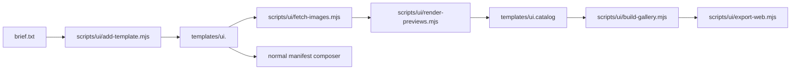

# UI template architecture

Praxis contains 18 original website heroes. Each one is a single React component, so templates are offered only for the React frameworks:

- Next.js JavaScript and TypeScript
- Vite React JavaScript and TypeScript

Vue, Astro and Angular projects always get the plain starter.

## Template modules

Every hero lives in `cli/templates/ui.<id>/`:

- `brief.txt` — the original brief: component, picture list and design notes;
- `template.json` — name, description, traits, theme, component name and the pictures to download;
- `manifest.json` — the overlays the composer applies;
- `files/shared/` — `DESIGN.md` and `public/design/websites/<id>/` pictures;
- `files/<framework>-<language>/` — the page entry plus the component.

TypeScript projects get the component byte for byte. JavaScript projects get the same file with only its type annotations removed.

## Authoring pipeline



Pictures are not stored in the briefs; `ui:images` downloads them from the URLs in `template.json`. Previews bundle each hero with Vite exactly as a generated project ships it and screenshot it in Chromium with reduced motion.

## Runtime selection

After framework selection, Next.js and Vite projects are asked whether to use a landing-page template:

- **Starter:** only framework and `styling.tailwind-shadcn` modules are composed.
- **Template:** the local gallery or terminal selector returns a style ID; `ui.<id>` is added after styling.

The style manifest first copies `files/shared`, then uses a framework/language-selected overlay with `replace: true` to replace the starter page.

## Gallery boundary

The gallery is offline and bundled:

1. a local HTTP server binds to a random `127.0.0.1` port;
2. only known gallery/catalog/preview resources are served;
3. the browser can filter, open live previews, and submit one style;
4. the waiting CLI receives and validates the selection;
5. headless/declined/failed browser flows use the terminal selector.

The gallery does not download templates or upload user data.

## Generated design provenance

Template mode copies the hero's `DESIGN.md` to:

- `DESIGN.md` in frontend-only projects;
- `frontend/DESIGN.md` in fullstack projects.

Starter mode does not copy it.

## Safe modification workflow

Do not edit the generated catalog or gallery by hand. Add or replace a hero from its brief, then refresh pictures, previews and the gallery:

```bash
npm --workspace cli run ui:add -- path/to/brief.txt --id <id>
npm --workspace cli run ui:images
npm --workspace cli run ui:previews
npm --workspace cli run ui:gallery
npm --workspace cli run ui:verify
npm --workspace cli run ui:matrix -- --target vite-ts --install --build
```

`ui:gallery` also exports the live previews, screenshots, pictures and `web/lib/ui-templates.json` to the website. See [Testing](testing.md).

## Authoritative sources

- Catalog types and IDs: [`cli/src/ui/catalog.ts`](../cli/src/ui/catalog.ts)
- Selection: [`cli/src/ui/resolveUi.ts`](../cli/src/ui/resolveUi.ts)
- Gallery server: [`cli/src/ui/gallery.ts`](../cli/src/ui/gallery.ts)
- Authoring pipeline: [`cli/scripts/ui/`](../cli/scripts/ui/)
- Generated catalog: [`cli/templates/ui.catalog/`](../cli/templates/ui.catalog/)
